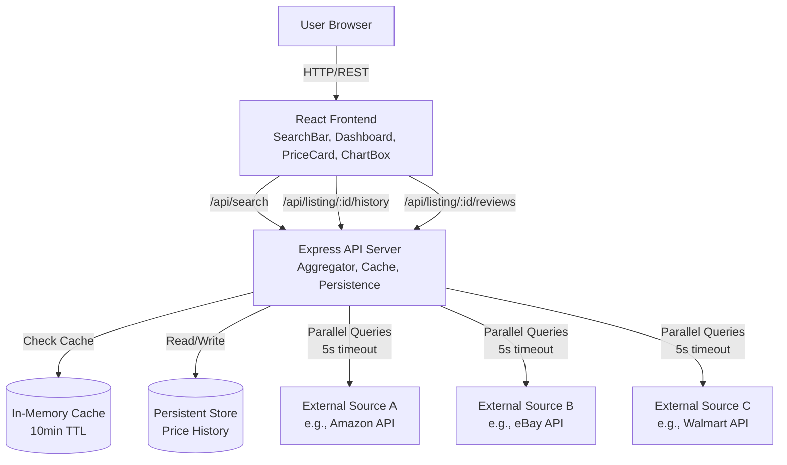

# Design Document

## Overview

PRO Market Dashboard is a full-stack web application that aggregates product listings from multiple online sources, enabling users to search, compare prices, view historical trends, and receive data-driven purchase recommendations. The system consists of three primary layers:

1. **Frontend (React)**: A responsive single-page application providing search, filtering, sorting, and visualization capabilities
2. **Backend API (Node.js/Express)**: RESTful service orchestrating data aggregation, caching, and persistence
3. **Data Layer**: In-memory cache and persistent storage for price history and listings

The application emphasizes performance through parallel source queries, intelligent caching, and debounced user input. The core value proposition is presenting a unified view of the product market landscape with minimal latency while providing actionable recommendations through composite scoring algorithms.

### Key Design Principles

- **Parallel Aggregation**: Query multiple sources concurrently to minimize response time
- **Graceful Degradation**: Continue operation even when individual sources fail
- **Cache-First**: Serve cached data when available to reduce external API load and improve responsiveness
- **Progressive Enhancement**: Provide basic functionality immediately, with enhanced features (price history, reviews) loaded on-demand
- **Separation of Concerns**: Clear boundaries between presentation, business logic, and data access layers

---

## Architecture

### System Architecture



### Component Architecture

**Frontend Components**:
- **App**: Root component managing global state and routing
- **SearchBar**: Input component with debouncing, validation, and category filter
- **Dashboard**: Results container managing sort order and displaying PriceCards
- **PriceCard**: Individual listing display with expand/collapse for reviews
- **ChartBox**: Price history visualization using a charting library
- **BestPickBanner**: Highlighted recommendation component

**Backend Modules**:
- **Server**: Express application setup with middleware (CORS, body-parser, error handling)
- **Router**: Route definitions mapping endpoints to controllers
- **AggregatorService**: Core business logic for querying sources, deduplication, scoring
- **SourceAdapters**: Interface implementations for each external source (normalization layer)
- **CacheManager**: In-memory cache with TTL management
- **PersistenceService**: Database operations for price history
- **ScoringEngine**: CompositeScore calculation and BestPick selection

### Data Flow

**Search Flow**:
1. User types query → SearchBar debounces 300ms
2. SearchBar validates input → sends GET /api/search?q={query}&category={category}
3. Backend checks cache → if HIT, return cached response with header
4. If MISS → AggregatorService queries all SourceAdapters in parallel (Promise.all with 5s timeout)
5. Each adapter returns normalized Listings array
6. AggregatorService deduplicates, computes CompositeScore, sorts by score
7. AggregatorService caches result with 10min TTL
8. Backend returns Listings array + BestPick
9. Frontend renders PriceCards, highlights lowest price, displays BestPick banner

**Price History Flow**:
1. User clicks PriceCard → Dashboard requests GET /api/listing/:id/history?range=30
2. Backend queries persistent store for price records within range
3. If <2 records, return empty with flag
4. Backend returns PriceHistory array with timestamps
5. ChartBox renders line chart with date/price axes

**Background Recording**:
- Each time AggregatorService fetches fresh data, PersistenceService stores price snapshot with timestamp
- Duplicate check: if record exists within 1-hour window for same listing, update instead of insert

---

## Components and Interfaces

### Frontend Components

#### SearchBar Component

**Props**: None (controlled by internal state)

**State**:
```typescript
{
  query: string,
  category: string, // "All" | "Electronics" | "Books" | "Clothing" | "Home & Kitchen" | "Sports"
  isLoading: boolean,
  validationError: string | null
}
```

**Methods**:
- `handleInputChange(value: string)`: Updates query, debounces API call by 300ms
- `handleCategoryChange(category: string)`: Updates category filter, triggers search
- `validateInput(query: string)`: Returns error message if empty/whitespace, else null
- `submitSearch()`: Validates and dispatches search action if valid

**Events Emitted**:
- `onSearchSubmit(query: string, category: string)`: Triggered after validation passes

---

#### PriceCard Component

**Props**:
```typescript
{
  listing: Listing,
  isLowestPrice: boolean,
  isBestPick: boolean,
  onExpand: (listingId: string) => void,
  onClickBuyLink: (listingId: string) => void
}
```

**State**:
```typescript
{
  isExpanded: boolean,
  reviews: Review[] | null,
  loadingReviews: boolean
}
```

**Display Elements**:
- Product name (bold, 18px)
- Source badge (colored pill)
- Price (large, currency formatted)
- Star rating (visual 5-star icon + numeric)
- Review count (clickable to expand)
- "Lowest Price" badge (conditional)
- "Best Pick" badge (conditional)
- Expand/collapse button for reviews

**Methods**:
- `toggleExpand()`: Fetches reviews from API if not cached, toggles expansion
- `renderStars(rating: number)`: Returns JSX for star icons (filled/half/empty)

---

#### ChartBox Component

**Props**:
```typescript
{
  listingId: string,
  productName: string,
  range: 7 | 30 | 90 // days
}
```

**State**:
```typescript
{
  priceHistory: Array<{timestamp: Date, price: number}>,
  isLoading: boolean,
  error: string | null
}
```

**Chart Configuration**:
- Library: Chart.js or Recharts (React-friendly)
- X-axis: Date labels (formatted based on range: "Jan 15" for 30/90 day, "Mon" for 7 day)
- Y-axis: Price with currency symbol
- Line color: Theme primary color
- Tooltip: Show exact date and price on hover

**Methods**:
- `fetchHistory(range: number)`: GET /api/listing/:id/history?range={range}
- `renderInsufficientData()`: Display message when <2 data points
- `handleRangeChange(newRange: number)`: Updates range, refetches data

---

#### Dashboard Component

**Props**:
```typescript
{
  listings: Listing[],
  bestPick: Listing | null,
  sourcesCount: number,
  isLoading: boolean,
  error: string | null
}
```

**State**:
```typescript
{
  sortBy: "bestMatch" | "lowestPrice" | "highestRating" | "mostReviews",
  categoryFilter: string,
  selectedListingId: string | null // for chart display
}
```

**Methods**:
- `sortListings(listings: Listing[], sortBy: string)`: Client-side sort implementation
- `findLowestPrice(listings: Listing[])`: Returns listing ID with minimum price
- `handleSortChange(sortBy: string)`: Updates sort state, re-renders
- `renderNoResults()`: Empty state UI with suggestions
- `renderError()`: Error state UI with retry button

---

### Backend API Interfaces

#### GET /api/search

**Query Parameters**:
- `q` (required): Search query string, min 1 character
- `category` (optional): Category filter, one of predefined categories

**Response** (200 OK):
```json
{
  "listings": [
    {
      "id": "src1_prod123",
      "productName": "Apple AirPods Pro",
      "source": "Amazon",
      "sourceUrl": "https://amazon.com/...",
      "price": 24999,
      "currency": "INR",
      "rating": 4.5,
      "reviewCount": 1203,
      "category": "Electronics",
      "compositeScore": 85.3,
      "fetchedAt": "2025-01-15T10:30:00Z"
    }
  ],
  "bestPick": { /* same structure as listing */ },
  "sourcesCount": 3,
  "cachedAt": null // or ISO timestamp if cache hit
}
```

**Error Response** (400 Bad Request):
```json
{
  "error": "Missing required parameter: q"
}
```

**Cache Headers**:
- `X-Cache: HIT` or `X-Cache: MISS`
- `Cache-Control: private, max-age=600`

---

#### GET /api/listing/:id/history

**Path Parameters**:
- `id` (required): Listing identifier

**Query Parameters**:
- `range` (optional): Days of history, default 30, allowed values: 7, 30, 90

**Response** (200 OK):
```json
{
  "listingId": "src1_prod123",
  "productName": "Apple AirPods Pro",
  "history": [
    {
      "timestamp": "2025-01-01T00:00:00Z",
      "price": 25999
    },
    {
      "timestamp": "2025-01-08T00:00:00Z",
      "price": 24999
    }
  ],
  "dataPoints": 2
}
```

**Response** (200 OK, insufficient data):
```json
{
  "listingId": "src1_prod123",
  "history": [],
  "dataPoints": 0,
  "message": "Insufficient history data"
}
```

---

#### GET /api/listing/:id/reviews

**Path Parameters**:
- `id` (required): Listing identifier

**Response** (200 OK):
```json
{
  "listingId": "src1_prod123",
  "reviews": [
    {
      "author": "John D.",
      "rating": 5,
      "text": "Excellent product, great sound quality...",
      "date": "2025-01-10",
      "verified": true,
      "sourceReviewUrl": "https://amazon.com/review/..."
    }
  ],
  "totalReviews": 1203,
  "averageRating": 4.5,
  "available": true
}
```

**Response** (200 OK, no reviews):
```json
{
  "listingId": "src1_prod123",
  "reviews": [],
  "available": false,
  "message": "Reviews unavailable"
}
```

---

### Backend Service Interfaces

#### AggregatorService

```typescript
class AggregatorService {
  constructor(
    sourceAdapters: SourceAdapter[],
    cacheManager: CacheManager,
    persistenceService: PersistenceService,
    scoringEngine: ScoringEngine
  )

  async search(query: string, category?: string): Promise<SearchResult>
  // Returns: { listings, bestPick, sourcesCount, cachedAt }
  // Logic:
  // 1. Generate cache key from query+category
  // 2. Check cache, return if hit
  // 3. Promise.allSettled with 5s timeout per source adapter
  // 4. Combine fulfilled results, log rejected
  // 5. Deduplicate by (productName, source)
  // 6. Compute composite scores
  // 7. Sort by score descending
  // 8. Select best pick
  // 9. Store price snapshots
  // 10. Cache result
  // 11. Return

  async getListingHistory(
    listingId: string, 
    rangeDays: number
  ): Promise<PriceHistory[]>
  // Delegates to PersistenceService

  async getListingReviews(listingId: string): Promise<ReviewResponse>
  // Parses listingId to extract source, delegates to appropriate SourceAdapter
}
```

#### SourceAdapter (Interface)

```typescript
interface SourceAdapter {
  sourceName: string
  
  async search(query: string, category?: string): Promise<Listing[]>
  // Returns normalized Listing array
  // Throws error on failure (handled by AggregatorService)
  
  async getReviews(productId: string): Promise<Review[]>
  // Returns normalized Review array
  // Returns empty array if not available
}
```

**Concrete Implementations**:
- `AmazonAdapter`: Calls Amazon Product Advertising API or web scraping
- `EbayAdapter`: Calls eBay Finding API
- `WalmartAdapter`: Calls Walmart Open API

Each adapter normalizes external response structure to internal Listing/Review schema.

---

#### ScoringEngine

```typescript
class ScoringEngine {
  calculateCompositeScore(
    listing: Listing, 
    allListings: Listing[]
  ): number
  // Formula: (0.5 × priceRank) + (0.3 × ratingNorm) + (0.2 × reviewCountNorm)
  // priceRank: normalized inverse rank (lowest price = 1.0)
  // ratingNorm: rating / 5.0
  // reviewCountNorm: log-scaled review count within result set (0-1 range)
  // Returns: score 0-100

  selectBestPick(listings: Listing[]): Listing | null
  // Returns listing with highest compositeScore
  // Tiebreaker: lowest price
  // Returns null if <2 listings

  determineBestPickReason(bestPick: Listing, allListings: Listing[]): string
  // Returns: "Best price" | "Highest rated" | "Most reviewed" | "Best value"
  // Logic: 
  //   If lowest price → "Best price"
  //   Else if highest rating → "Highest rated"
  //   Else if most reviews → "Most reviewed"
  //   Else → "Best value"
}
```

---

#### CacheManager

```typescript
class CacheManager {
  private cache: Map<string, {data: any, expiresAt: number}>

  set(key: string, data: any, ttlSeconds: number): void
  // Stores data with expiration timestamp

  get(key: string): any | null
  // Returns data if exists and not expired, else null
  // Removes expired entries on access

  generateKey(query: string, category?: string): string
  // Returns hash or concatenated string: "search:{query}:{category}"

  clear(): void
  // Flushes all cache entries (useful for testing)
}
```

---

#### PersistenceService

```typescript
interface PersistenceService {
  async storePriceSnapshot(
    listingId: string, 
    price: number, 
    timestamp: Date
  ): Promise<void>
  // Inserts or updates price record
  // Deduplication: if record exists within 1-hour window, update instead of insert

  async getPriceHistory(
    listingId: string, 
    rangeDays: number
  ): Promise<Array<{timestamp: Date, price: number}>>
  // Returns ordered array (oldest to newest)

  async getListingMetadata(listingId: string): Promise<Listing | null>
  // Optional: store full listing metadata for faster retrieval
}
```

**Storage Options**:
- **Development**: SQLite file-based database
- **Production**: PostgreSQL or MongoDB
- **Schema** (SQL example):
  ```sql
  CREATE TABLE price_history (
    id SERIAL PRIMARY KEY,
    listing_id VARCHAR(255) NOT NULL,
    price INTEGER NOT NULL,
    timestamp TIMESTAMP NOT NULL,
    UNIQUE(listing_id, timestamp)
  );
  CREATE INDEX idx_listing_timestamp ON price_history(listing_id, timestamp);
  ```

---

## Data Models

### Listing

```typescript
interface Listing {
  id: string              // Format: "{source}_{productId}"
  productName: string     // Normalized product name
  source: string          // Source identifier (e.g., "Amazon", "eBay")
  sourceUrl: string       // Direct link to product page
  price: number           // Price in smallest currency unit (e.g., cents/paise)
  currency: string        // ISO 4217 code (e.g., "USD", "INR")
  rating: number          // Star rating 0.0-5.0, one decimal precision
  reviewCount: number     // Total number of reviews
  category: string        // One of: Electronics, Books, Clothing, Home & Kitchen, Sports
  compositeScore: number  // Computed score 0-100
  fetchedAt: string       // ISO timestamp of when data was retrieved
  imageUrl?: string       // Optional: product thumbnail URL
}
```

**Validation Rules**:
- `id`: Non-empty string, unique within result set
- `productName`: Non-empty, max 200 characters
- `price`: Positive integer
- `rating`: 0.0 ≤ rating ≤ 5.0
- `reviewCount`: Non-negative integer
- `category`: Must match predefined category list
- `compositeScore`: 0 ≤ score ≤ 100

---

### Review

```typescript
interface Review {
  author: string          // Reviewer display name
  rating: number          // Star rating 1-5
  text: string            // Review body, max 200 chars in display
  date: string            // ISO date string (YYYY-MM-DD)
  verified: boolean       // Whether purchase was verified
  sourceReviewUrl: string // Link to full review on source site
}
```

---

### PriceHistory

```typescript
interface PriceHistoryRecord {
  timestamp: Date         // When the price was recorded
  price: number           // Price at that time (smallest currency unit)
}

type PriceHistory = PriceHistoryRecord[]
```

---

### SearchResult

```typescript
interface SearchResult {
  listings: Listing[]     // All listings sorted by compositeScore descending
  bestPick: Listing | null // Top-scored listing, null if <2 results
  sourcesCount: number    // Number of sources that returned results
  cachedAt: string | null // ISO timestamp if cache hit, null if fresh
}
```

---

### API Error Response

```typescript
interface ErrorResponse {
  error: string           // Human-readable error message
  code?: string           // Optional error code (e.g., "INVALID_QUERY")
  details?: any           // Optional additional context
}
```

---

## Error Handling

### Frontend Error Handling

**Input Validation Errors**:
- Display inline error message below SearchBar input
- Prevent API call submission
- Clear error on valid input

**API Request Errors**:
- Network failure: Display "Network error, please check your connection" with retry button
- 400 Bad Request: Display specific error message from API response
- 500 Server Error: Display "Service temporarily unavailable, please try again later"
- Timeout: Display "Request timed out, please try again"
- Preserve previous results if any existed before error

**Component-Level Errors**:
- ChartBox: Display "Unable to load price history" if API fails
- PriceCard reviews: Display "Reviews unavailable" if fetch fails
- Fallback: Show generic error boundary if unexpected error occurs

**Error Recovery**:
- All error states include retry action (button or link)
- Automatic retry after 5 seconds for transient network errors (optional UX enhancement)

---

### Backend Error Handling

**Request Validation**:
- Missing required parameters: Return 400 with descriptive message
- Invalid parameter values: Return 400 with validation details
- Malformed requests: Return 400 with parsing error

**External Source Failures**:
- Individual source timeout (5s): Log warning, continue with other sources
- Individual source error: Log error details, continue with other sources
- All sources fail: Return 200 with empty listings array and error note
- Partial failure: Return 200 with available results, log failed sources

**Cache Failures**:
- Cache read error: Log error, proceed with fresh fetch
- Cache write error: Log error, return data to client (graceful degradation)

**Database Failures**:
- Price history write failure: Log error, do not block search response
- Price history read failure: Return empty history with error flag
- Connection pool exhausted: Implement retry with exponential backoff (max 3 attempts)

**Logging Strategy**:
- Error logs: Full stack trace, request context, timestamp
- Warning logs: Source timeouts, cache misses
- Info logs: Cache hits, successful requests
- Use structured logging (JSON format) for production

**Circuit Breaker Pattern** (optional enhancement):
- Track failure rate per source
- Open circuit after 50% failure rate over 10 requests
- Half-open after 60s cooldown
- Close circuit after 3 consecutive successes

---

## Testing Strategy

### Unit Testing

**Frontend Component Tests** (Jest + React Testing Library):
- **SearchBar**: 
  - Test debouncing behavior (mock timers)
  - Test validation logic for empty/whitespace input
  - Test category filter changes
  - Test submit event emission
- **PriceCard**: 
  - Test rendering of all listing fields
  - Test conditional badge display (lowest price, best pick)
  - Test star rating calculation (full, half, empty stars)
  - Test expand/collapse interaction
  - Test click-to-buy navigation
- **ChartBox**: 
  - Test rendering with valid data (≥2 points)
  - Test "insufficient data" message (<2 points)
  - Test range toggle functionality
  - Test loading and error states
- **Dashboard**: 
  - Test client-side sorting (all 4 modes)
  - Test category filtering
  - Test "no results" empty state
  - Test error state with retry
  - Test lowest price highlighting

**Backend Unit Tests** (Jest/Mocha):
- **ScoringEngine**: 
  - Test composite score calculation with various input ranges
  - Test normalization functions (price rank, rating, review count)
  - Test best pick selection with ties
  - Test best pick reason determination
- **CacheManager**: 
  - Test set/get with TTL expiration
  - Test cache key generation
  - Test expired entry removal
  - Test cache clear
- **AggregatorService** (with mocked dependencies):
  - Test search with single source success
  - Test search with mixed source success/failure
  - Test deduplication logic
  - Test cache hit path
  - Test cache miss path
  - Test sorting by composite score
- **SourceAdapter** implementations:
  - Test response normalization for each source
  - Test error handling for API failures
  - Test review fetching and formatting

**Testing Edge Cases**:
- Empty search results
- Single listing result (no best pick)
- All sources failing
- Very large result sets (100+ listings)
- Extreme price ranges (0.01 to 1,000,000)
- Missing optional fields (imageUrl, reviews)
- Special characters in product names
- Currency formatting edge cases

---

### Integration Testing

**API Endpoint Tests** (Supertest):
- **GET /api/search**: 
  - Test successful search with results
  - Test cache header on cache hit
  - Test 400 error for missing query parameter
  - Test empty results handling
  - Test category filtering
  - Test source timeout handling (mock slow source)
- **GET /api/listing/:id/history**: 
  - Test valid history retrieval (7, 30, 90 day ranges)
  - Test insufficient data response
  - Test invalid listing ID
- **GET /api/listing/:id/reviews**: 
  - Test successful review retrieval
  - Test unavailable reviews response
  - Test review excerpt truncation (>200 chars)

**Database Integration Tests**:
- Test price snapshot storage with deduplication
- Test price history retrieval with date range filtering
- Test concurrent write handling (race conditions)

**Source Adapter Integration Tests** (with real API sandbox/test accounts):
- Test actual API calls to each source (if sandbox available)
- Verify response normalization
- Test rate limiting behavior
- Test timeout handling

---

### End-to-End Testing

**Critical User Flows** (Playwright/Cypress):
1. **Search and Compare Flow**:
   - User enters search query
   - Results display with multiple sources
   - Lowest price is highlighted
   - Best pick banner appears
   - User clicks a price card
   - Source website opens in new tab

2. **Price History Flow**:
   - User selects a listing
   - Price chart displays
   - User toggles between 7/30/90 day views
   - Chart updates correctly

3. **Sorting and Filtering Flow**:
   - User searches for product
   - User changes sort order (lowest price, highest rating, most reviews)
   - Results re-order immediately
   - User selects category filter
   - Results filter to category

4. **Error Recovery Flow**:
   - Simulate network failure
   - Error message displays
   - User clicks retry
   - Results load successfully

5. **Review Expansion Flow**:
   - User expands a price card
   - Reviews load and display
   - "Read more" links are functional
   - User collapses card

**Performance Testing**:
- Measure search response time (target: <2s for cache miss, <200ms for cache hit)
- Measure chart render time (target: <500ms)
- Test concurrent user load (target: 100 concurrent searches without degradation)

**Accessibility Testing**:
- Keyboard navigation for all interactive elements
- Screen reader compatibility (ARIA labels)
- Color contrast meets WCAG AA standards
- Focus indicators visible

---

### Test Coverage Goals

- **Frontend**: ≥80% statement coverage, 100% of critical paths
- **Backend**: ≥85% statement coverage, 100% of API endpoints
- **Integration**: 100% of API contracts, 100% of database operations
- **E2E**: 100% of critical user flows

---

### Continuous Integration

**Pre-commit Hooks**:
- Run linter (ESLint)
- Run unit tests for changed files
- Run type checking (TypeScript)

**CI Pipeline** (GitHub Actions / GitLab CI):
1. Install dependencies
2. Run linter
3. Run all unit tests
4. Run integration tests
5. Run E2E tests (headless)
6. Generate coverage report
7. Build production bundle
8. Deploy to staging (on main branch)

**Quality Gates**:
- All tests pass
- Coverage ≥80%
- No critical linter errors
- Build succeeds


## Correctness Properties

*A property is a characteristic or behavior that should hold true across all valid executions of a system—essentially, a formal statement about what the system should do. Properties serve as the bridge between human-readable specifications and machine-verifiable correctness guarantees.*

The PRO Market Dashboard contains several core algorithms and data transformations that are well-suited for property-based testing. While much of the application involves UI rendering, external API calls, and database operations (which are better tested with integration and example-based tests), the following universal properties capture the essential correctness guarantees for the business logic layer:

---

### Property 1: UI Rendering Completeness

*For any* Listing object, when rendered as a PriceCard component, the output SHALL contain all required fields: product name, source name, price (with currency symbol), star rating (numeric value to one decimal place), and review count.

**Validates: Requirements 4.1, 6.1**

---

### Property 2: Input Validation Rejects Whitespace

*For any* string composed entirely of whitespace characters (spaces, tabs, newlines, or any combination thereof), the SearchBar validation SHALL reject the input, display a validation error message, and SHALL NOT submit an API request.

**Validates: Requirements 1.3**

---

### Property 3: Listing Count Preservation

*For any* array of N Listings returned from the aggregator, the Dashboard SHALL render exactly N PriceCard components in the results area.

**Validates: Requirements 1.2**

---

### Property 4: Multi-Source Aggregation Completeness

*For any* set of source responses where K sources return results successfully, the combined Listings array SHALL contain all listings from those K sources, with no loss of data during combination.

**Validates: Requirements 2.1**

---

### Property 5: Deduplication by Name and Source

*For any* set of Listings containing duplicates (where two or more listings have identical productName AND identical source), the deduplicated output SHALL contain exactly one listing per unique (productName, source) pair, retaining the most recently fetched entry based on the fetchedAt timestamp.

**Validates: Requirements 2.4**

---

### Property 6: CompositeScore Descending Sort

*For any* array of Listings with computed compositeScore values, the sorted output SHALL be ordered in strictly descending order by compositeScore (highest score first).

**Validates: Requirements 2.5**

---

### Property 7: Category Filtering Correctness

*For any* array of Listings and any selected category value, when category is NOT "All", the filtered output SHALL contain only Listings whose category field exactly matches the selected category. When category IS "All", the filtered output SHALL contain all Listings regardless of their category value.

**Validates: Requirements 3.2, 3.3**

---

### Property 8: Lowest Price Identification

*For any* non-empty array of Listings, exactly one Listing SHALL be identified as having the lowest price—specifically, the Listing with the minimum price value. If multiple Listings share the minimum price, one (any) of them SHALL be identified.

**Validates: Requirements 4.2**

---

### Property 9: Cross-Source Product Separation

*For any* set of Listings where two or more have identical productName but different source values, all such Listings SHALL be rendered as separate PriceCard components (no source-level deduplication at display).

**Validates: Requirements 4.3**

---

### Property 10: Source Count Accuracy

*For any* array of Listings, the count of distinct sources SHALL equal the number of unique source field values across all Listings in the array.

**Validates: Requirements 4.4**

---

### Property 11: Star Rating Rendering

*For any* rating value in the range [0.0, 5.0], the star rating renderer SHALL produce the correct visual representation consisting of full stars (★), half stars (⯨), and empty stars (☆), where the total always equals 5 stars and the filled portion accurately represents the rating value.

**Validates: Requirements 6.4**

---

### Property 12: Review Text Truncation

*For any* review text string exceeding 200 characters, the displayed excerpt SHALL be truncated to exactly 200 characters, followed by an ellipsis ("..."), and SHALL include a "Read more" link to the full review on the source website.

**Validates: Requirements 6.5**

---

### Property 13: BestPick Selection Algorithm

*For any* array of Listings where the count is ≥ 2:
1. Each Listing SHALL have a compositeScore computed via the formula: `(0.5 × normalized_price_rank) + (0.3 × normalized_rating) + (0.2 × normalized_review_count)`, where each factor is normalized to [0, 1] within the result set
2. The Listing with the highest compositeScore SHALL be selected as BestPick
3. If two or more Listings share the highest compositeScore, the Listing with the lowest price among them SHALL be selected as BestPick

*For any* array of Listings where the count is < 2, no BestPick SHALL be selected (null/undefined).

**Validates: Requirements 7.1, 7.2, 7.3, 7.4**

---

### Property 14: Client-Side Sorting Correctness

*For any* array of Listings and any sort criterion (Best Match by compositeScore, Lowest Price by price, Highest Rating by rating, or Most Reviews by reviewCount), the sorted output SHALL be ordered correctly according to the selected criterion:
- Best Match: descending by compositeScore
- Lowest Price: ascending by price
- Highest Rating: descending by rating
- Most Reviews: descending by reviewCount

**Validates: Requirements 8.2**

---

### Property 15: Cache Hit Behavior

*For any* unique search query Q, when requested multiple times within a 10-minute window:
1. The first request SHALL result in a cache MISS (X-Cache: MISS header, cachedAt field is null)
2. Subsequent requests within 10 minutes SHALL result in a cache HIT (X-Cache: HIT header, cachedAt field contains the timestamp of the first request)
3. The response data from cache hits SHALL be identical to the original cached response

**Validates: Requirements 10.1, 10.2**

---

### Property 16: Price History Temporal Deduplication

*For any* PriceHistory record with (listingId, price, timestamp), when a new record is stored with the same listingId and a timestamp within a 1-hour window (±3600 seconds) of an existing record's timestamp, the system SHALL update the existing record rather than creating a duplicate entry. The result SHALL be that no two records for the same listingId exist with timestamps within 1 hour of each other.

**Validates: Requirements 10.4**

---

## Property-Based Testing Implementation Notes

**Recommended PBT Library**:
- **JavaScript/TypeScript**: `fast-check` (mature, TypeScript-first, excellent documentation)
- Alternative: `jsverify` (established but less actively maintained)

**Test Configuration**:
- Minimum 100 iterations per property test
- Use shrinking to find minimal failing examples when tests fail
- Tag each test with: `Feature: pro-market-dashboard, Property {number}: {title}`

**Generator Strategy**:
- **Listings**: Generate with varied price ranges (1-1000000), ratings (0.0-5.0), review counts (0-100000), categories from predefined list
- **Whitespace strings**: Generate combinations of spaces, tabs (\t), newlines (\n), and Unicode whitespace characters
- **Timestamps**: Generate within realistic ranges (2020-present) for cache and deduplication tests
- **Arrays**: Vary sizes from 0 to 100+ elements to test performance and edge cases

**Integration with Unit Tests**:
- Property tests validate universal correctness of algorithms
- Unit tests validate specific examples, error conditions, and integration points
- Both are necessary for comprehensive coverage

